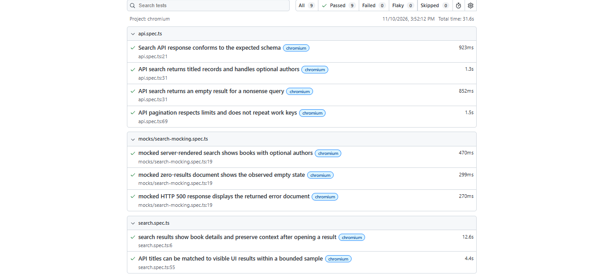

# Open Library search tests

This project tests book search on [Open Library](https://openlibrary.org) with
Playwright and TypeScript. It covers the search results page, the Search API,
and mocked responses for cases that are difficult to reproduce reliably against
the live site.

## Running the tests

To Install the Dependencies
```sh
npm init playwright@latest
```

```sh
npm run test
```

To run one part of the suite:

```sh
npm run test:ui
npm run test:api
npm run test:mocks
```

Playwright saves its HTML report in `playwright-report/`. After a run, open it
with:

```sh
npm run report
```

Failed tests retain screenshots and traces to help with debugging.



## How the tests work

The test inputs are kept in the root-level `data/` folder. Edit
`data/search-test-data.json` to change the live UI/API search queries, limits,
and expected response sizes. `data/mock-search-scenarios.json` contains the
mocked result, empty-state, and error cases, including their sample book data.
The Playwright scripts load these files and define tests from their scenarios.

The UI tests search for the configured title, check the configured number of
result cards, and compare a bounded sample of API titles with visible UI
results. They normalize titles before comparing them because the catalog and
its relevance ranking can change; the tests don't expect the UI and API to
return results in exactly the same order.

The API tests validate the Search API response schema (including required
fields and optional author names), titles, empty searches, and two consecutive
pages. Pagination checks that each page respects the requested limit and that
work keys don't repeat when present.

## Search page and network mocks

Open Library renders its search results in the HTML document returned by
`GET /search?q=...`. The result cards use `.searchResultItem`, with titles in
`.booktitle a` and author details in `.bookauthor` when available. During
inspection, the populated page did not fetch `/search.json`; that endpoint is
covered separately by the API tests. The live empty-search page displayed
“No matching books or authors”.

The mock tests intercept only search-page navigations and return HTML using the
same result-card structure. The scenarios in the mock data file cover books
(including one without an author), an empty result, and a `500` response. Each
test checks that the request was intercepted and verifies what appeared in the
page. The route is removed after each test, so it cannot affect live tests.

Calls to the Search API go through a shared helper. It queues those requests
and spaces their start times by at least one second, rather than adding sleeps
to individual tests.
